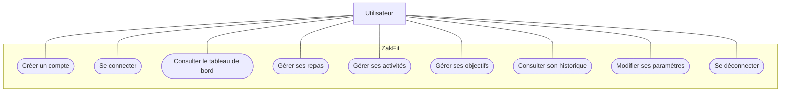

# Diagramme de cas d’utilisation — ZakFit

## Règles d’accès

- L’inscription et la connexion sont accessibles sans session.
- Les autres actions nécessitent une session active.
- Chaque utilisateur consulte et modifie uniquement ses propres données.
