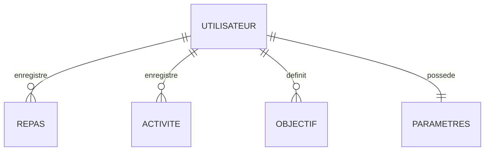

# Modèle conceptuel des données — ZakFit

## Règles de gestion

- Un utilisateur peut enregistrer zéro, un ou plusieurs repas.
- Un utilisateur peut enregistrer zéro, une ou plusieurs activités.
- Un utilisateur peut définir zéro, un ou plusieurs objectifs.
- Chaque repas, activité ou objectif appartient à un seul utilisateur.
- Chaque utilisateur possède exactement un jeu de paramètres, propre à son compte.
  Ce jeu est créé à l’inscription.
